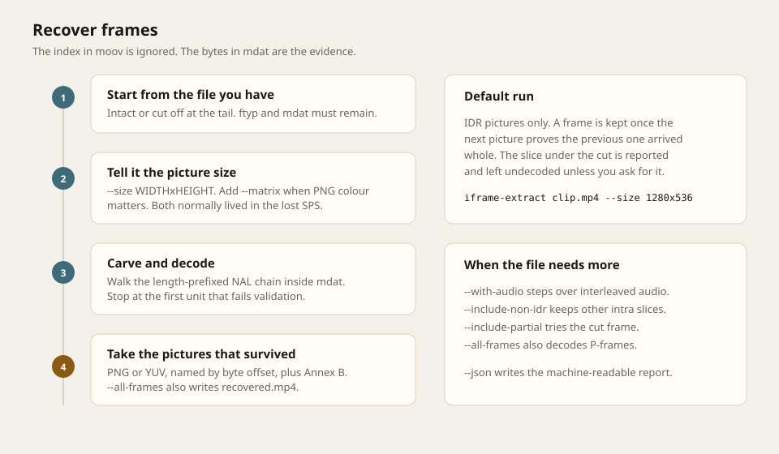
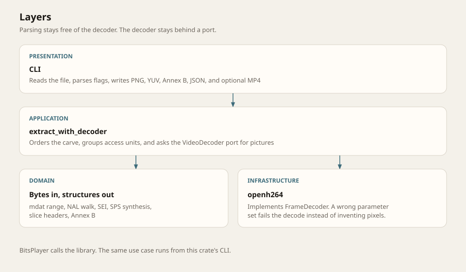
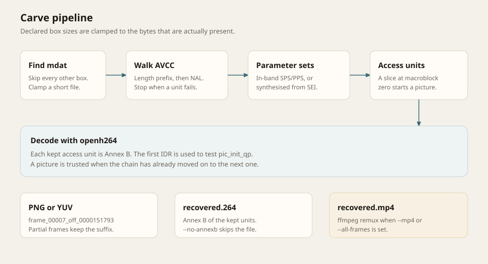

# iframe-extract

Recovers pictures from an MP4 or QuickTime MOV by carving the H.264 or H.265 bitstream in `mdat`. It does not read `moov`, even when that box is still in the file.

A truncated file has lost the sample index and the `avcC`/`hvcC` box that held the parameter sets. An ordinary demuxer then cannot decode a frame. This tool rebuilds both from the bytes that survived the cut.

BitsPlayer calls this library for the Extract tab. The `iframe-extract` binary is the same carve, driven from the command line.

## Recover frames



```bash
cargo run --release -- clip.mp4 --size 1280x536 -o out/
```

`--size` is required. Resolution is taken from the arguments, because a missing SPS cannot be trusted to supply it. `--matrix` chooses BT.709 or BT.601 for PNG colour; that value lived in the SPS VUI.

Stderr shows a progress bar for each phase. `-q` silences it.

| Flag | Effect |
| --- | --- |
| `--size WxH` | Picture size. Required. |
| `-o DIR` | Output directory. Defaults to `out/`. |
| `--format png\|yuv` | `yuv` is planar 4:2:0, for a byte-exact compare against another decoder. |
| `--matrix bt709\|bt601` | Colour matrix for PNG. Defaults to BT.709. |
| `--codec auto\|h264\|h265` | Codec. Defaults to detecting it from the bitstream. |
| `--include-non-idr` | Also emit intra slices that are not IDR. |
| `--include-partial` | Also attempt the frame that straddles the cut. |
| `--with-audio` | Step over non-video regions when an audio track is interleaved in `mdat`. |
| `--all-frames` | Also decode P-frames, and remux `recovered.mp4` with ffmpeg. |
| `--mp4` | Remux the recovered Annex B stream to `recovered.mp4`. Needs ffmpeg. |
| `--json FILE` | Machine-readable report. |
| `--emit-annexb FILE` | Annex B path. Defaults to `<output>/recovered.264`, or `.265` for H.265. |
| `--no-annexb` | Skip the Annex B file. |
| `-q` | No progress bar or summary. |

Pictures are named `frame_00007_off_0000151793.png`. A partial frame adds `_partial`. There are no timestamps: the timescale lived in `moov`, and the frame rate lived in the SPS VUI. The byte offset is stable.

## How the program is put together



| Layer | Role |
| --- | --- |
| `src/presentation/` | The CLI: flags, file read, PNG/YUV/Annex B/JSON/MP4 write. |
| `src/application/` | `extract_with_decoder`. Orders the carve and talks to the decoder port. |
| `src/domain/` | `mdat` range, codec detection, NAL walk, x264 SEI, SPS/PPS synthesis, slice headers, Annex B, and `hevc/` (parameter sets, CABAC validator, search). No decoder crate and no filesystem. |
| `src/infrastructure/` | openh264 and ffmpeg behind `FrameDecoder` / `VideoDecoder`. |

A second decoder can implement the same port. The carver does not change.

## The carve



**Find `mdat`, ignore everything else.** Declared box sizes are clamped to the file length. A truncated file's `mdat` header still advertises its original size.

**Walk the AVCC chain.** Samples are stored as a 4-byte length and then a NAL. Walking that chain from the start of `mdat` rebuilds frame boundaries without an index. The chain stops at the first unit that fails validation. With `--with-audio`, a second pass steps over interleaved non-video regions.

Padding after the cut tries hard to look like data, so units are checked on several axes: the `forbidden_zero_bit`, a whitelist of the NAL types x264 emits, the `nal_ref_idc` values the spec fixes for each type, a plausibility bound on length, and a slice-header check on the macroblock address. Together these reject `startcodes`, `fakeboxes`, and `mp4tail` padding.

**Recover the parameter sets.** In-band SPS/PPS are used when the encoder repeated them. Otherwise they are synthesised from `--size` plus x264's options SEI, which is the first NAL of a typical file and therefore survives a tail cut:

```text
cabac=1 ref=3 8x8dct=1 chroma_qp_offset=-2 bframes=3 keyint=48 rc=crf crf=23.0 ...
```

The remaining fields follow x264's header writer. `log2_max_frame_num` is 4 for ordinary GOPs. `pic_order_cnt_type` is 0 (lsb 6) unless there are no B-frames, in which case it is 2. DPB size uses x264's max(ref, 1+reorder, pyramid?4:1) rule. Scaling matrices are absent. `gaps_in_frame_num_value_allowed` is 0. On a baseline encode the synthesised PPS comes out byte-identical to the real one.

`pic_init_qp` is the one field the SEI cannot pin down. Plain CRF often matches `round(crf)`, but `--stitchable` and ABR leave x264's PPS default of 26. The tool tries the SEI hint first and validates each candidate by decoding the first IDR. CABAC context initialisation depends on SliceQPY, so a wrong guess desynchronises the decoder and fails the decode. If that still fails, a short fallback tries the other common entropy, transform, and POC flavours so a missing or non-x264 SEI is not fatal.

**Group access units.** A VCL NAL with `first_mb_in_slice == 0` starts a new picture, so multi-slice encodes group without access-unit delimiters.

A picture is trusted only once the chain has moved on to the next picture. Without that rule a multi-slice frame whose last slice fell past the cut looks whole, because every surviving slice is individually well formed.

**Decode.** openh264. By default only IDR pictures are decoded. `--include-non-idr` adds other intra slices. `--all-frames` also decodes P-frames and, with ffmpeg on the path, remuxes `recovered.mp4`.

**MOV.** QuickTime and MP4 share the box layout the carver relies on, so a `.mov` is walked the same way: `wide` in place of `free`, and pre-`ftyp` files that open straight on `wide` or `mdat`. The report records which container the `ftyp` brand names.

## H.265

**Detection.** Nothing outside `moov` names the codec, so both NAL grammars are probed against `mdat`. The one most confidently made of coded slices wins: the score is the lower confidence bound of the slice share, so a pure but tiny run of fabricated units cannot beat a truncated file's few real pictures. `--codec` overrides it. HEVC's two-byte NAL header is far more redundant than H.264's (layer id 0, temporal id non-zero, IRAP pictures on the base sub-layer), which makes it reject padding even more reliably. Dolby Vision RPUs and the second view of MV-HEVC spatial video are accepted in the chain and left out of decoding.

**Parameter sets.** In-band VPS/SPS/PPS win when the encoder repeated them (Intel/AMD VAAPI do). Otherwise there is far less to go on than with x264: ffmpeg's libx265 wrapper puts the options SEI in `hvcC` with the parameter sets, so a truncated file keeps neither. Worse, ffmpeg's HEVC decoder renders a wrong guess as a plausible picture without any error, so it cannot judge candidates the way openh264 does for H.264.

So candidates are proven rather than guessed. `domain::hevc::validate` runs the full CABAC syntax of an intra slice (SAO, coding quadtree, intra modes, transform tree, residuals) without reconstructing anything. Every field that changes how a bin is decoded (CTB and block sizes, transform depth, SAO, sign hiding, cu_qp_delta, transform skip, WPP, bit depth, and the QP that seeds the contexts) desynchronises the arithmetic decoder when wrong, and a desynchronised decoder does not finish each substream exactly on its stop bit. The right set always does.

The search tries x265's presets, Apple VideoToolbox (iPhone) and Intel's hardware encoder first, each across every `init_qp`, then a staged sweep: slice-header layouts the keyframes admit, then slice-data fields in order of how common they are, on every core. The chosen set is then re-checked against every keyframe, and any that disagree join the probes. Fields no parse can observe (strong intra smoothing, scaling lists, chroma QP offsets, inter-only settings) are taken from the nearest known encoder.

**Decode.** ffmpeg through the `VideoDecoder` port; openh264 has no HEVC support.

Real iPhone recordings (iPhone X on iOS 13, iPhone 12 mini on iOS 16; HEVC with LPCM audio and metadata tracks interleaved) recover every keyframe byte-identical to ffmpeg's decode, intact and truncated. ffmpeg applies the MOV clean aperture and rotation by default; compare with `-apply_cropping codec -noautorotate` to see the coded picture this tool writes.

## Check a corpus

```bash
cargo build --release
python3 scripts/evaluate.py
python3 scripts/evaluate.py --png-ssim 6
cargo test --release
```

The smoke tests skip themselves when the corpus is absent. Comparison is done on planar YUV. Both decoders are conformant, so the pass criterion is byte identity. PNG output differs from ffmpeg's PNGs by about 0.998 mean SSIM; that gap is the YUV-to-RGB step, where two implementations disagree by under one LSB per channel.

`tests/hevc.rs` covers H.265 and MOV without the corpus, on files it encodes with ffmpeg: keyframes byte-identical to ffmpeg's decode of the intact file, a truncated MOV with AAC, a configuration only the sweep finds, codec detection, and the validator rejecting each wrong field.

## Limits

- Head truncation is out of scope. The tool needs `ftyp` and `mdat` at the start, and the SEI as the first NAL when the parameter sets have to be synthesised.
- `--size` is required, and `--matrix` is a choice you supply. Both lived in structures a tail cut can destroy.
- There are no timestamps, for the same reason.
- A partial frame is reported. With `--include-partial` the decoder may still refuse a truncated IDR. openh264 does not emit a picture for a slice-incomplete IDR.
- H.265 needs ffmpeg on the path to decode. Encoders outside the known profiles are found by the sweep, but fields no parse can see are borrowed from the nearest known encoder, so such frames can be close rather than bit-exact.
- The H.264 synthesis table follows x264. Other encoders use the search path: the opposite entropy coder, 8×8 transform, POC type, and every `pic_init_qp`. That covers typical High, Main, and Baseline IDRs. It will not invent a scaling matrix or an interlaced SPS.
